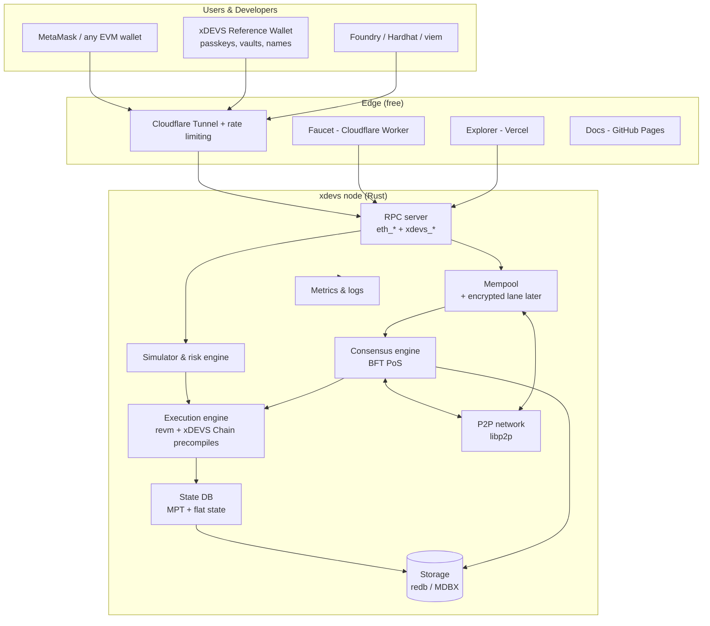
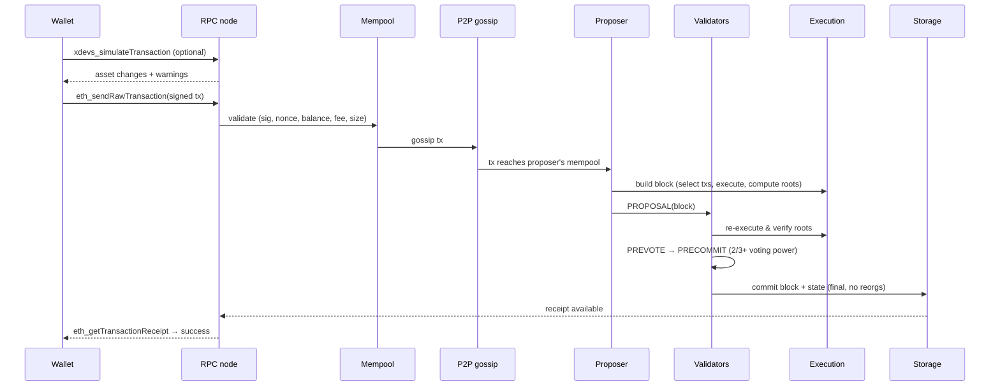
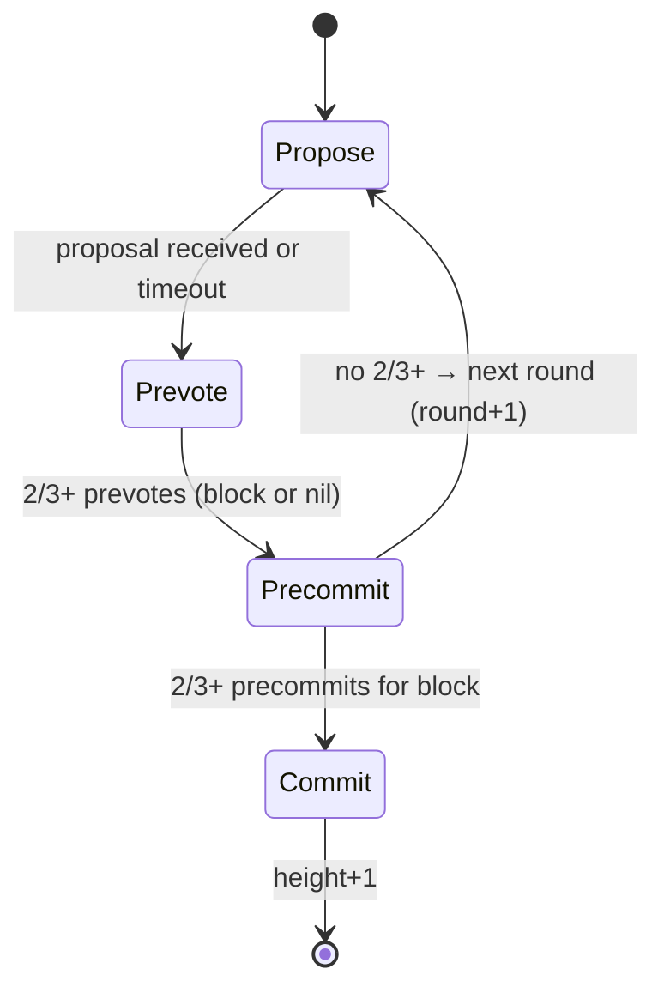
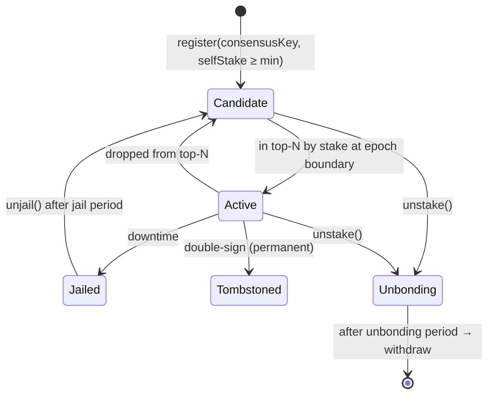
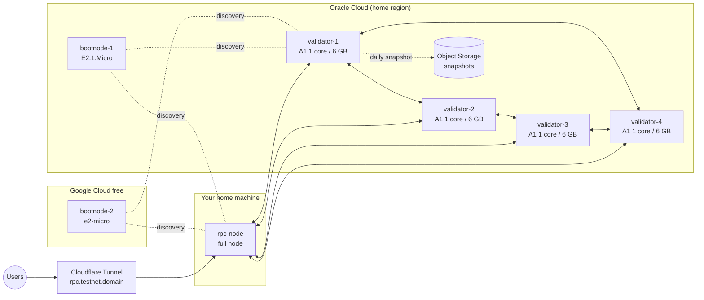
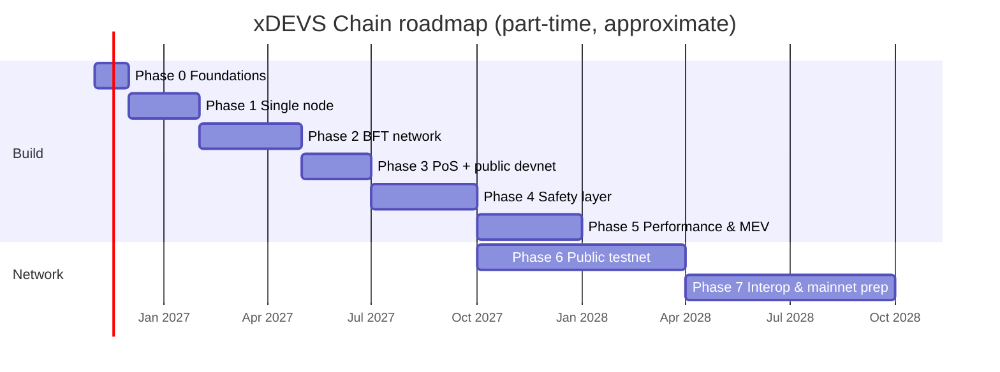

# xDEVS Chain — Implementation Plan

> **xDEVS Chain** (built by **THE xDEVS**): a Layer‑1, EVM‑compatible, Proof‑of‑Stake blockchain with sub‑second finality, built around one idea that no major chain has made its core identity: **protecting users at the protocol level** from scams, lost keys, front‑running and drained wallets.
>
> **Status:** Planning · **Target:** Public testnet, built and hosted with **$0** in resources · **Primary language:** Rust (node), Solidity (system contracts), TypeScript (SDK, apps)

---

## Table of Contents

1. [Vision & Positioning](#1-vision--positioning)
2. [Goals, Non‑Goals & Design Principles](#2-goals-non-goals--design-principles)
3. [Competitive Analysis: What's Wrong With Existing Chains](#3-competitive-analysis-whats-wrong-with-existing-chains)
4. [xDEVS Chain at a Glance](#4-xdevs-chain-at-a-glance)
5. [System Architecture](#5-system-architecture)
6. [Architecture Decision Records (ADRs)](#6-architecture-decision-records-adrs)
7. [Repository & Code Structure](#7-repository--code-structure)
8. [Core Data Structures](#8-core-data-structures)
9. [Cryptography](#9-cryptography)
10. [Execution Layer](#10-execution-layer)
11. [Consensus & Proof of Stake](#11-consensus--proof-of-stake)
12. [Networking (P2P)](#12-networking-p2p)
13. [Mempool](#13-mempool)
14. [Storage & State](#14-storage--state)
15. [Fee Model](#15-fee-model)
16. [The User‑Safety Layer (xDEVS Chain's Signature Features)](#16-the-user-safety-layer-xdevs-chains-signature-features)
17. [MEV Protection](#17-mev-protection)
18. [System Contracts (Solidity)](#18-system-contracts-solidity)
19. [JSON‑RPC API](#19-json-rpc-api)
20. [Tokenomics (Testnet XDS)](#20-tokenomics-testnet-xds)
21. [Genesis Configuration](#21-genesis-configuration)
22. [Interoperability & Bridges](#22-interoperability--bridges)
23. [Developer & User Tooling](#23-developer--user-tooling)
24. [Infrastructure & Deployment ($0 Budget)](#24-infrastructure--deployment-0-budget)
25. [Security](#25-security)
26. [Testing Strategy](#26-testing-strategy)
27. [Roadmap (Phases, Tasks, Exit Criteria)](#27-roadmap-phases-tasks-exit-criteria)
28. [Phase 1 Week‑by‑Week Plan](#28-phase-1-week-by-week-plan)
29. [Risk Register](#29-risk-register)
30. [Path to Mainnet & Legal Checklist](#30-path-to-mainnet--legal-checklist)
31. [Learning Resources](#31-learning-resources)
32. [Glossary](#32-glossary)
33. [Appendix: Parameters, Configs & Templates](#33-appendix-parameters-configs--templates)

---

## 1. Vision & Positioning

### 1.1 The problem

Blockchains compete almost entirely on **speed and cost**. Meanwhile, the things that actually hurt ordinary users are left to wallets and apps to fix (or not):

- People lose funds forever because they lost a **seed phrase**.
- **Scams, phishing and address poisoning** steal billions of dollars every year.
- Forgotten **unlimited token approvals** get drained years later.
- **MEV bots** front‑run and sandwich normal users' trades.
- **Bridges** secured by small multisigs get hacked for hundreds of millions.

### 1.2 xDEVS Chain's answer

> **xDEVS Chain is the first Layer‑1 designed to protect its users by default — while being as fast as the fastest chains and fully compatible with Ethereum tools.**

| Pillar | What it means |
|---|---|
| **Safe by default** | Smart accounts with passkeys and recovery, optional time‑locked Guardian Vaults, native names, built‑in transaction simulation, expiring approvals, encrypted mempool. |
| **Fast** | Sub‑second to ~1–2 s deterministic finality (BFT). No reorgs after commit. |
| **Compatible** | EVM‑equivalent execution via `revm`. MetaMask, Foundry, Hardhat, viem, ethers, Solidity all work on day one. |
| **Accessible** | Validators run on modest hardware. The entire testnet runs on free cloud resources. |

### 1.3 Tagline options

- *"xDEVS Chain — the chain that has your back."*
- *"Fast like Solana. Compatible like Ethereum. Safe like nothing else."*

### 1.4 Name & brand

xDEVS Chain is built by the startup **THE xDEVS**. The chain is named after the company so every user of the chain learns the brand.

| Item | Value |
|---|---|
| Company | THE xDEVS |
| Chain | **xDEVS Chain** |
| Native coin | **XDS** (testnet: **tXDS**), 18 decimals |
| Smallest unit | "dev" (1 XDS = 10¹⁸ dev) |
| Name service suffix | `.xdevs` (e.g. `alice.xdevs`) |
| Token standard (expiring approvals) | XDRC‑20 (ERC‑20 compatible) |
| RPC namespace / code prefix | `xdevs_` / `xdevs-` |

**Name checks done (Nov 2026, web search only):** no existing blockchain or coin named "xDEVS" was found; "XChain", "XCoin", "XDEV" and "XDV" are already in use and were rejected. No token using the **XDS** ticker was found.

**Still to do before announcing the name:**

- [ ] Confirm **XDS** is free on CoinGecko and CoinMarketCap.
- [ ] Trademark search for "xDEVS", "xDEVS Chain" and "XDS" in India (IP India), the US (USPTO) and the EU (EUIPO), classes 9, 36 and 42 — ideally confirmed by a trademark lawyer.
- [ ] Secure a domain (`xdevs.com` and `xdevs.ai` are already used by unrelated companies), the GitHub org and social handles.
- [ ] Decide early whether the chain will later move under a separate foundation (see §30.2) — sharing the company name makes that separation harder to show.

---

## 2. Goals, Non‑Goals & Design Principles

### 2.1 Goals (testnet)

1. A **real, public, multi‑validator network** reachable from the internet, with MetaMask support.
2. **EVM equivalence**: any Solidity contract that runs on Ethereum runs on xDEVS Chain unchanged.
3. **Deterministic finality** in ~1–2 s with BFT Proof of Stake.
4. **User‑safety features** (Section 16) implemented and usable from a reference wallet.
5. Native testnet token **tXDS**, a faucet, an explorer, docs and a TypeScript SDK.
6. Everything built and hosted on **free resources**.
7. Open to **community validators** once stable.

### 2.2 Non‑goals (for now)

| Non‑goal | Why |
|---|---|
| Sharding | Huge complexity; not needed at testnet scale. |
| Blob / data‑availability layer (EIP‑4844 style) | xDEVS Chain is an L1 for apps, not a rollup DA layer. Can be revisited. |
| A brand‑new VM or language | EVM compatibility is a bigger advantage than novelty. |
| Writing BFT consensus from scratch | Consensus bugs are the #1 way new chains die. Use an audited library. |
| Selling tokens | Testnet tokens are free and worthless by design until the legal path (Section 30) is done. |
| Beating Solana's raw TPS | xDEVS Chain targets "fast enough + safe + decentralized", not benchmark records. |

### 2.3 Design principles

1. **Don't invent what you can reuse.** Reuse `revm`, `alloy`, a BFT library, `libp2p`. Spend creativity on the safety layer.
2. **Ethereum compatibility is sacred.** Every deviation must be opt‑in and must not break existing tooling.
3. **Safety features are opt‑in and never break finality.** No protocol‑level "reversals". Protection lives in account logic that users choose.
4. **Simplicity beats cleverness.** Every extra component is attack surface.
5. **Everything behind traits.** Consensus, storage and execution are swappable modules.
6. **Measure before optimizing.** Parallel execution, async execution, etc. come after benchmarks.
7. **Facts vs. opinions.** On‑chain data is fact. Risk flags, labels and simulation warnings are *advice* and are always labelled as such.

---

## 3. Competitive Analysis: What's Wrong With Existing Chains

### 3.1 Comparison table

| Chain | Consensus | Execution | Finality (approx.) | Strengths | Key flaws xDEVS Chain learns from |
|---|---|---|---|---|---|
| **Bitcoin** | Proof of Work | Bitcoin Script (UTXO) | ~60 min (6 confirmations, probabilistic) | Most secure, most decentralized, simple | Slow, low throughput, minimal programmability, energy use |
| **Ethereum** | PoS (Gasper: LMD‑GHOST + Casper FFG) | EVM, single‑threaded | ~13 min (2 epochs) | Largest ecosystem, very decentralized, EVM is the standard | Slow finality, expensive at peaks, sequential execution, liquidity split across many L2s, MEV, seed‑phrase UX, state growth |
| **Solana** | PoS + Proof of History + TowerBFT (moving to Alpenglow) | Sealevel (parallel), SBF programs | Seconds (sub‑second targeted) | Very fast, cheap, parallel execution, local fee markets | Multiple full outages 2021–2024, heavy validator hardware → fewer independent operators, spam, Rust programs are hard to write safely, not EVM |
| **Sui** | Mysticeti (DAG BFT) | Move VM, object model, parallel | Sub‑second | Safe language (Move), parallel, fast | Small ecosystem, new language, not EVM |
| **Aptos** | BFT (Jolteon/HotStuff family) | Move VM + Block‑STM | Sub‑second | Block‑STM parallel execution, Move | Small ecosystem, not EVM |
| **Avalanche** | Snowman consensus | EVM (C‑Chain) + L1s/subnets | ~1–2 s | Fast finality, customizable L1s | Fragmentation across L1s, validator overhead |
| **Cosmos chains** | CometBFT (Tendermint) | Cosmos SDK modules | ~1–6 s | App‑specific chains, IBC interoperability | Each chain must bootstrap its own security, fragmented liquidity |
| **Polkadot** | BABE/SASSAFRAS + GRANDPA | Wasm runtimes | ~12–60 s | Shared security | Complexity, steep learning curve |
| **Newer high‑performance EVMs** (Monad, Sei, etc.) | Various BFT | Parallel / pipelined EVM | ~1 s | EVM + speed | Smaller, younger validator sets; still no user‑safety focus |

### 3.2 Problems that **every** chain still has

| Problem | Current state | xDEVS Chain approach |
|---|---|---|
| Seed‑phrase loss | Wallet‑level fixes, mostly optional add‑ons | Smart accounts by default, passkeys, social recovery (§16.1) |
| Scams / theft | Nothing at protocol level | Guardian Vaults with cancel window (§16.2) |
| Address poisoning | Wallet warnings only | Native names + RPC‑level similarity warnings (§16.3–16.4) |
| Unlimited approvals | ERC‑20 standard allows infinite, permanent approvals | Expiring approvals + account‑level allowance policies (§16.5) |
| Blind signing | Users sign hex they can't read | Built‑in simulation RPC with human‑readable results (§16.4) |
| MEV | PBS, private mempools (centralizing) | Encrypted mempool (§17) |
| Bridge hacks | Multisig bridges | Light‑client / IBC‑style bridges only (§22) |
| State growth | Unsolved on most chains | Pruning + history expiry now, state rent research later (§14.5) |

### 3.3 Honest reality check

- **The blockchain trilemma is real.** xDEVS Chain picks: *strong safety + fast finality + moderate decentralization (≤150 validators)*.
- **MEV can be reduced, not eliminated.**
- **Decentralization comes from people, not code.** A chain with 4 validators owned by one person is a testnet, not a decentralized network. That changes only by onboarding independent validators.
- **Security comes from economic value.** A testnet has no value at stake, so its "security" is cryptographic and operational, not economic.

---

## 4. xDEVS Chain at a Glance

| Property | Value (testnet, initial) |
|---|---|
| Type | Layer‑1, EVM‑equivalent, Proof of Stake |
| Consensus | Tendermint‑style BFT (via Malachite; commonware as fallback) |
| Finality | Deterministic, on commit (~1–2 s) |
| Block time | 2 s at launch → 1 s target |
| Execution | `revm`, sequential at launch → Block‑STM parallel later |
| State commitment | Ethereum Merkle‑Patricia Trie (keeps `eth_getProof` compatibility) |
| Storage | `redb` behind a trait → MDBX if benchmarks demand |
| Networking | `libp2p` (QUIC/TCP, Noise, Yamux, Gossipsub, Kademlia) |
| Accounts | EOAs + EIP‑7702 delegation + canonical xDEVS Smart Account |
| Signatures | secp256k1 (Ethereum txs), secp256r1/P‑256 (passkeys), Ed25519 (consensus/p2p) |
| Native token | **XDS** (testnet: **tXDS**), 18 decimals |
| Fees | EIP‑1559 base fee (80% burned, 20% treasury) + priority fee to proposer + local fee markets |
| Max validators | 100 (testnet) |
| Signature feature | Protocol‑level user safety (Section 16) |
| Hosting | Oracle Cloud Always Free + home machine + free SaaS tiers |

---

## 5. System Architecture

### 5.1 High‑level component diagram



### 5.2 Layers

| Layer | Responsibility | Crate(s) |
|---|---|---|
| Primitives | Types: tx, block, header, receipt, address, hashes, RLP encoding | `xdevs-primitives` |
| Crypto | Keys, signatures, hashing, BLS later | `xdevs-crypto` |
| Storage | Key‑value tables, batches, snapshots | `xdevs-storage` |
| State | Account/storage state, trie, state root | `xdevs-state` |
| Execution | Run txs/blocks with revm, gas, fees, precompiles, system calls | `xdevs-execution` |
| Mempool | Validate, order and evict pending txs | `xdevs-mempool` |
| Consensus | Proposer selection, voting, commit, validator set | `xdevs-consensus` |
| Network | Peer discovery, gossip, block sync | `xdevs-network` |
| RPC | JSON‑RPC (HTTP + WebSocket) | `xdevs-rpc` |
| Node | Wiring, config, CLI, lifecycle | `xdevs-node`, `bin/xdevs` |

### 5.3 Transaction lifecycle



### 5.4 Block production loop (per height)

1. Consensus picks the **proposer** for `(height, round)` (stake‑weighted round robin).
2. Proposer pulls best txs from mempool (by effective tip, respecting nonces and local fee markets).
3. Proposer **executes** them via revm on top of parent state, producing `state_root`, `receipts_root`, `logs_bloom`, `gas_used`.
4. Proposer broadcasts `Proposal { block, round, pol_round, signature }`.
5. Each validator **re‑executes**, checks roots and rules, then **prevotes** (block hash or nil).
6. On 2/3+ prevotes → **precommit**. On 2/3+ precommits → **decided**.
7. Node writes block, state diff, receipts and the **commit certificate** atomically.
8. Mempool removes included txs; RPC subscribers get `newHeads`/`logs`.

---

## 6. Architecture Decision Records (ADRs)

Keep each ADR as a file in `docs/adr/NNNN-title.md`. Initial decisions:

### ADR‑0001: Build our own node on `revm` + `alloy` (not a Reth fork)

| Option | Pros | Cons |
|---|---|---|
| **A. Own node on revm + alloy (chosen)** | Full control over consensus, tx types, safety features; you learn every layer; small binary for free VMs | Must build storage, RPC, sync yourself |
| B. Reth SDK + custom consensus via Engine API | Battle‑tested storage/RPC/txpool | Heavy (RAM/disk), large codebase to learn, custom tx types harder |
| C. Cosmos SDK + EVM module (Go) | Mature PoS/governance modules | Go not Rust, less control over EVM details |

**Revisit** at the end of Phase 3. If storage/RPC become the bottleneck, migrate execution to Reth components.

### ADR‑0002: Tendermint‑style BFT via Malachite

- Deterministic finality, simple mental model, proven for a decade (CometBFT).
- Malachite is a Rust implementation with a formal specification.
- Fallback: commonware's consensus primitives.
- Consensus is behind a `ConsensusEngine` trait so it can be swapped.
- **Before starting**, verify the library's current license, maintenance status and API.

### ADR‑0003: Execute‑before‑vote (state root in the same block)

- Proposer executes; validators re‑execute before prevoting.
- Ethereum‑like: `stateRoot` in a header is the state *after* that block, so tooling just works.
- Later optimization: pipelined/asynchronous execution (consensus on ordering, execution lagging by one block). Not before benchmarks show the need.

### ADR‑0004: Ethereum MPT for state commitment

- Keeps `eth_getProof`, light clients and bridge proofs compatible.
- Use `alloy-trie` for root computation over a **flat state** table (compute roots incrementally from changed keys).

### ADR‑0005: `redb` first, MDBX later

- `redb` is pure Rust, ACID, simple, cross‑compiles to ARM64 easily.
- Everything behind a `Database` trait; benchmark against MDBX in Phase 5.

### ADR‑0006: Safety features live in accounts and RPC, never in finality

- No protocol‑level reversals. A finalized tx is final.
- Guardian Vault delays are enforced by the **account's own code**, which the user opts into.

### ADR‑0007: Ed25519 for consensus/p2p keys, BLS later

- Ed25519 is fast and simple. Commit certificates = list of signatures at first.
- Move to BLS12‑381 aggregate signatures when the validator set grows (smaller certificates, cheaper light clients).

---

## 7. Repository & Code Structure

### 7.1 Monorepo layout

```
xdevs-chain/
├── Cargo.toml                  # Rust workspace
├── rust-toolchain.toml
├── crates/
│   ├── primitives/             # Tx, Block, Header, Receipt, Address, U256, RLP (alloy)
│   ├── crypto/                 # secp256k1, p256, ed25519, keccak, keystores
│   ├── storage/                # Database trait, redb impl, tables, batches
│   ├── state/                  # StateDB, flat state, trie root, state diffs
│   ├── execution/              # revm integration, block executor, precompiles, system calls
│   ├── parallel/               # Block-STM (Phase 5)
│   ├── mempool/                # tx pool, ordering, eviction, encrypted lane
│   ├── consensus/              # ConsensusEngine trait + Malachite adapter, validator set
│   ├── network/                # libp2p behaviours: gossip, discovery, sync
│   ├── rpc/                    # jsonrpsee server: eth_, net_, web3_, xdevs_
│   ├── simulator/              # tx simulation, asset diffs, risk flags
│   ├── genesis/                # genesis parsing, predeploys, initial state
│   ├── metrics/                # prometheus exporters
│   ├── node/                   # wiring, config, services, lifecycle
│   └── testutils/              # in-process multi-node harness
├── bin/
│   ├── xdevs/                  # the node binary
│   ├── xdevs-cli/              # keys, validator ops, tx sending
│   └── xdevs-loadgen/          # load generator / spammer
├── contracts/                  # Foundry project
│   ├── src/system/             # Staking, Governance, Treasury, FeeConfig
│   ├── src/accounts/           # XdevsSmartAccount, modules, GuardianVault
│   ├── src/xns/                # xDEVS Name Service
│   ├── src/tokens/             # XDRC-20 reference (expiring approvals)
│   ├── src/paymaster/          # gas sponsorship
│   └── test/                   # unit, fuzz, invariant tests
├── sdk/
│   └── ts/                     # @xdevs/sdk: viem chain defs + xdevs_ actions
├── apps/
│   ├── wallet/                 # reference wallet (Next.js, passkeys)
│   ├── explorer/               # lightweight explorer (Next.js) + indexer
│   ├── faucet/                 # Cloudflare Worker
│   └── docs/                   # docs site (static)
├── deploy/
│   ├── ansible/                # provisioning playbooks
│   ├── systemd/                # unit files
│   ├── configs/                # devnet/testnet node configs, genesis files
│   └── scripts/                # snapshot, backup, upgrade helpers
├── docs/
│   ├── adr/                    # architecture decisions
│   ├── specs/                  # protocol specs (tx types, consensus params, precompiles)
│   └── runbooks/               # ops procedures
├── tests/
│   └── e2e/                    # multi-node, RPC compat, chaos tests
└── .github/workflows/          # CI
```

### 7.2 Workspace `Cargo.toml` (sketch)

> Versions: always pin to the **latest stable** release on crates.io at setup time and commit `Cargo.lock`. `<ver>` below is a placeholder.

```toml
[workspace]
resolver = "2"
members = ["crates/*", "bin/*"]

[workspace.package]
edition = "2021"
license = "Apache-2.0"
rust-version = "<current stable>"

[workspace.dependencies]
# Ethereum types & EVM
alloy-primitives = "<ver>"
alloy-rlp        = "<ver>"
alloy-consensus  = "<ver>"   # tx envelope types (legacy, 2930, 1559, 7702)
alloy-trie       = "<ver>"
revm             = "<ver>"
# Async & RPC
tokio            = { version = "<ver>", features = ["full"] }
jsonrpsee        = { version = "<ver>", features = ["server", "macros"] }
# Networking
libp2p           = { version = "<ver>", features = ["tokio", "quic", "tcp", "noise", "yamux", "gossipsub", "kad", "identify", "request-response", "ping"] }
# Storage
redb             = "<ver>"
# Crypto
k256             = "<ver>"
p256             = "<ver>"
ed25519-dalek    = "<ver>"
# Utilities
serde            = { version = "<ver>", features = ["derive"] }
serde_json       = "<ver>"
toml             = "<ver>"
thiserror        = "<ver>"
anyhow           = "<ver>"
tracing          = "<ver>"
tracing-subscriber = "<ver>"
clap             = { version = "<ver>", features = ["derive"] }
prometheus       = "<ver>"
# Testing
proptest         = "<ver>"
```

### 7.3 Core traits (the module boundaries)

```rust
/// Persistent key-value storage with atomic batches.
pub trait Database: Send + Sync + 'static {
    type Tx<'a>: DbTx where Self: 'a;
    type TxMut<'a>: DbTxMut where Self: 'a;
    fn tx(&self) -> Result<Self::Tx<'_>, DbError>;
    fn tx_mut(&self) -> Result<Self::TxMut<'_>, DbError>;
}

/// Executes a block on top of a parent state and returns the outcome.
pub trait BlockExecutor: Send + Sync {
    fn execute(
        &self,
        parent: &SealedHeader,
        block: &Block,
        state: &mut dyn StateProvider,
    ) -> Result<ExecutionOutcome, ExecutionError>;
}

pub struct ExecutionOutcome {
    pub state_root: B256,
    pub receipts_root: B256,
    pub logs_bloom: Bloom,
    pub gas_used: u64,
    pub receipts: Vec<Receipt>,
    pub state_diff: StateDiff,
}

/// Abstraction over the BFT engine so Malachite / commonware are swappable.
#[async_trait::async_trait]
pub trait ConsensusEngine: Send + Sync {
    async fn run(self, app: Box<dyn ConsensusApp>) -> anyhow::Result<()>;
}

/// What the consensus engine needs from the application.
#[async_trait::async_trait]
pub trait ConsensusApp: Send + Sync {
    /// Build a block proposal for (height, round).
    async fn propose(&self, height: u64, round: u32) -> anyhow::Result<Block>;
    /// Validate a proposal received from another validator.
    async fn validate(&self, block: &Block) -> anyhow::Result<bool>;
    /// Persist a decided block with its commit certificate.
    async fn commit(&self, block: Block, cert: CommitCertificate) -> anyhow::Result<()>;
    /// Validator set active at `height` (read from Staking contract at epoch boundaries).
    async fn validator_set(&self, height: u64) -> anyhow::Result<ValidatorSet>;
}

/// Pending transaction pool.
pub trait TxPool: Send + Sync {
    fn add(&self, tx: RecoveredTx, origin: TxOrigin) -> Result<TxHash, PoolError>;
    fn best_txs(&self, base_fee: u128, gas_limit: u64) -> Vec<RecoveredTx>;
    fn on_block_committed(&self, block: &Block, receipts: &[Receipt]);
}
```

---

## 8. Core Data Structures

### 8.1 Block header (Ethereum‑compatible + xDEVS Chain fields)

| Field | Type | Notes |
|---|---|---|
| `parent_hash` | B256 | |
| `ommers_hash` | B256 | Constant empty‑list hash (compat) |
| `beneficiary` | Address | Proposer's fee recipient |
| `state_root` | B256 | MPT root after executing this block |
| `transactions_root` | B256 | |
| `receipts_root` | B256 | |
| `logs_bloom` | Bloom | |
| `difficulty` | U256 | Always 0 |
| `number` | u64 | Height |
| `gas_limit` | u64 | |
| `gas_used` | u64 | |
| `timestamp` | u64 | Seconds; must be > parent and ≤ now + drift |
| `extra_data` | Bytes | ≤ 32 bytes: client version |
| `mix_hash` | B256 | Used as `PREVRANDAO`: hash of previous commit certificate (weak randomness — documented) |
| `nonce` | u64 | Always 0 |
| `base_fee_per_gas` | u64 | EIP‑1559 |
| `withdrawals_root` | B256 | Empty (compat) |
| `parent_beacon_block_root` | B256 | Zero (compat) |
| `requests_hash` | B256 | Empty (compat) |

xDEVS Chain consensus data is **not** in the Ethereum header (to keep the header hash compatible with tooling). It's stored alongside:

```rust
pub struct XdevsBlock {
    pub header: Header,               // Ethereum-compatible header
    pub body: BlockBody,              // transactions
    pub consensus: ConsensusInfo,     // round, proposer, validator_set_hash
    pub last_commit: CommitCertificate, // 2/3+ precommit signatures for parent
}

pub struct CommitCertificate {
    pub height: u64,
    pub round: u32,
    pub block_hash: B256,
    pub signatures: Vec<(ValidatorIndex, Ed25519Signature)>, // BLS aggregate later
}
```

### 8.2 Transaction types

| Type | Name | Phase | Notes |
|---|---|---|---|
| `0x00` | Legacy (EIP‑155) | 1 | Requires chain ID (no unprotected replay) |
| `0x01` | Access list (EIP‑2930) | 1 | |
| `0x02` | Dynamic fee (EIP‑1559) | 1 | Default for wallets |
| `0x03` | Blob (EIP‑4844) | — | **Not supported** (non‑goal) |
| `0x04` | Set‑code (EIP‑7702) | 4 | EOAs delegate to xDEVS Smart Account |
| `0x6A` (tentative) | **xDEVS Native AA tx** | 6 | Sponsor field, P‑256 signature, policy hints. Pick a type byte not used by Ethereum or major L2s and document it. |

Mempool/RPC rejects unsupported types with a clear error.

### 8.3 Accounts

Same as Ethereum: `{ nonce, balance, code_hash, storage_root }`. EIP‑7702 delegated EOAs store the `0xef0100 || address` designator as code.

### 8.4 Receipts & logs

Ethereum format: `{ status, cumulative_gas_used, logs_bloom, logs[] }`. xDEVS Chain adds nothing to the canonical receipt (compat). Extra data (e.g., vault queue IDs) is emitted as **events**.

### 8.5 Chain identifiers

| Network | Chain ID | Purpose |
|---|---|---|
| Local devnet | `31337`‑style local ID (choose your own) | Dev machine only |
| xDEVS Chain Devnet | *Choose an unused ID, e.g. 7177xx* | Internal, frequently reset |
| xDEVS Chain Testnet | *Choose an unused ID* | Public, long‑lived |
| xDEVS Chain Mainnet | *Reserve later* | Future |

**Before publishing**, search chainlist.org and the `ethereum-lists/chains` repo to confirm your IDs are unused, then open a PR to register them (free).

---

## 9. Cryptography

| Purpose | Algorithm | Crate | Notes |
|---|---|---|---|
| Ethereum tx signatures | secp256k1 ECDSA | `k256` (via alloy) | Needed for MetaMask compatibility |
| Hashing | Keccak‑256 | `alloy-primitives` / `tiny-keccak` | Addresses, tries, tx hashes |
| Passkeys / WebAuthn | secp256r1 (P‑256) | `p256` | Exposed as `P256VERIFY` precompile at `0x100` (RIP‑7212 / EIP‑7951 address) |
| Consensus votes | Ed25519 | `ed25519-dalek` | Upgrade to BLS12‑381 aggregate later (`blst`) |
| P2P identity | Ed25519 | libp2p | Separate from consensus key |
| Encrypted mempool (later) | Threshold encryption (BLS‑based) | `blst` + custom / existing TPKE lib | Research phase |
| Keystores | scrypt + AES‑128‑CTR (Web3 Secret Storage v3) | `eth-keystore`‑style | Compatible with Ethereum tooling |

**Rules**

- Never implement primitives yourself. Use audited crates only.
- Constant‑time comparisons for secrets; zeroize keys in memory (`zeroize` crate).
- Validator consensus keys, p2p keys and fee‑recipient keys are **three different keys**.

---

## 10. Execution Layer

### 10.1 revm integration

- Build a `XdevsEvmConfig` that sets:
  - Spec ID: latest Ethereum hardfork supported by revm (e.g., Prague/Osaka) minus blob features.
  - `chain_id`, `block.coinbase`, `block.basefee`, `block.prevrandao`, `block.gas_limit`.
  - Custom precompiles (§10.3).
- Implement revm's `Database` trait over xDEVS Chain's `StateProvider` (cached reads + write buffer).
- Collect `ResultAndState` per tx → receipts + state diff.

### 10.2 Block execution steps

1. **Pre‑block system call** (if epoch boundary): call `Staking.onEpoch()` as a system tx (no signature, no gas charge) to distribute rewards and compute the next validator set.
2. For each tx:
   - Verify sender signature (cached from mempool recovery), nonce, chain ID, intrinsic gas, balance ≥ `gas_limit * max_fee + value`.
   - Compute **effective fee** = base fee + local fee (§15.2) + min(tip, max_fee − base − local).
   - Execute with revm.
   - Charge fees: base+local part split **80% burn / 20% treasury**; tip → `beneficiary`.
3. **Post‑block system call**: record proposer/signer participation for rewards and downtime tracking.
4. Compute `state_root`, `receipts_root`, `logs_bloom`.

### 10.3 Precompiles

| Address | Name | Phase | Purpose |
|---|---|---|---|
| `0x01`–`0x11` | Ethereum standard set | 1 | ecrecover, sha256, ripemd, identity, modexp, bn254, blake2f, point‑eval (disabled), BLS12‑381 |
| `0x100` | `P256VERIFY` | 4 | Passkey signature verification (cheap) |
| `0x0A00…0001` (xDEVS Chain range) | `ED25519VERIFY` | 4 | Verify Ed25519 sigs (light clients, bridges) |
| `0x0A00…0002` | `XDEVS_CONTEXT` | 4 | Returns current epoch, validator‑set hash, local fee for a contract |

Document every precompile in `docs/specs/precompiles.md` with gas cost formulas.

### 10.4 Gas schedule

- Use Ethereum's gas schedule unchanged (compat for gas estimation in tools).
- xDEVS Chain additions only for new precompiles.

### 10.5 Parallel execution (Phase 5): Block‑STM

- Optimistic concurrency: execute all txs in parallel against a **multi‑version memory**, record read/write sets, **validate** in order, **re‑execute** conflicting txs.
- Result is **identical** to sequential execution (deterministic). Required: a differential test that runs every block both ways and compares state roots.
- Only enable when validators have ≥ 4 cores; on 1‑core free VMs it gives nothing.

### 10.6 Determinism rules (critical)

- No floating point, no `HashMap` iteration order in consensus‑critical code (`BTreeMap` or `IndexMap`), no system time except the header timestamp, no randomness except `prevrandao`.
- Any non‑determinism = chain halt. Add a CI check that executes the same block on two different machines/architectures (x86_64 vs ARM64) and compares roots.

---

## 11. Consensus & Proof of Stake

### 11.1 Tendermint round structure



- **Safety:** tolerates up to `f` Byzantine validators where total voting power `≥ 3f + 1`.
- **Liveness:** needs ≥ 2/3 voting power online. If more than 1/3 is offline, the chain **halts safely** (no forks) rather than producing conflicting blocks.
- **Finality:** a committed block is final. No reorgs.

### 11.2 Timeouts (initial, tune with metrics)

| Timeout | Value | Increase per round |
|---|---|---|
| `timeout_propose` | 1000 ms | +500 ms |
| `timeout_prevote` | 500 ms | +250 ms |
| `timeout_precommit` | 500 ms | +250 ms |
| `timeout_commit` (block time padding) | 1000 ms → 500 ms | — |

### 11.3 Proposer selection

- Weighted round‑robin by voting power (CometBFT's proposer priority algorithm).
- Deterministic, given the validator set.

### 11.4 Validator lifecycle (Staking system contract)



### 11.5 Staking parameters (testnet)

| Parameter | Value |
|---|---|
| Epoch length | 3,600 blocks (~1 h at 1 s) |
| Max active validators | 100 |
| Min self‑stake | 10,000 tXDS |
| Delegation | Yes, from Phase 3 |
| Commission | 0–20%, max change 1%/day |
| Unbonding period | 1 day (testnet) / 14–21 days (mainnet) |
| Double‑sign slash | 5% of stake + permanent tombstone |
| Downtime | Signed < 50% of last 10,000 blocks → 0.01% slash + 10 min jail |
| Rewards | Block reward + tips → proposer bonus (5%) + signers pro‑rata by power |

### 11.6 Consensus ↔ execution interface

- At each epoch boundary, the `onEpoch` system call writes the next validator set into the Staking contract's storage.
- The consensus layer reads it via the `ConsensusApp::validator_set(height)` hook (a direct state read, not an RPC call).
- **Evidence**: double‑sign evidence (two signed votes for the same height/round with different block hashes) is gossiped and included in blocks; execution calls `Staking.slash(evidence)`.

### 11.7 Long‑range attacks & weak subjectivity

- PoS chains need **trusted checkpoints** for new nodes syncing from genesis (old keys could fork history).
- Publish recent block hashes on the docs site + GitHub; nodes accept `--trusted-checkpoint <height>:<hash>`.
- Unbonding period must exceed the time new nodes are allowed to trust stale checkpoints.

### 11.8 Validator key safety

- **Double‑sign protection DB**: each node stores the last (height, round, step) it signed and refuses to sign anything lower or conflicting. Never run the same validator key on two machines.
- Remote signer (TMKMS‑style) in Phase 6.

---

## 12. Networking (P2P)

### 12.1 Stack

- Transport: **QUIC** (primary) + TCP fallback; **Noise** encryption; **Yamux** multiplexing.
- Discovery: **Kademlia DHT** + static **bootnodes** + `identify`.
- Gossip: **Gossipsub v1.1** with peer scoring.
- Request/response: block sync, missing tx fetch, state snapshot chunks.

### 12.2 Gossip topics

| Topic | Payload | Validation before forwarding |
|---|---|---|
| `/xdevs/<chain>/tx/1` | Signed tx | Decodes, valid signature, chain ID, size ≤ 128 KB |
| `/xdevs/<chain>/consensus/proposal/1` | Proposal | Signed by expected proposer |
| `/xdevs/<chain>/consensus/vote/1` | Prevote/Precommit | Signed by an active validator |
| `/xdevs/<chain>/evidence/1` | Double‑sign evidence | Verifiable |
| `/xdevs/<chain>/enc-tx/1` | Encrypted tx (Phase 5+) | Size, fee commitment |

Consensus messages may use a dedicated validator‑only mesh (fewer hops, lower latency).

### 12.3 Sync protocols

1. **Block sync (Phase 2):** `GetBlocks { from, count }` → blocks + commit certificates; re‑execute and verify each.
2. **Checkpoint/snapshot sync (Phase 6):** download a state snapshot at a trusted height in chunks, verify against `state_root`, then block‑sync the tail.

### 12.4 Node roles

| Role | Validates? | Serves public RPC? | Exposed P2P? |
|---|---|---|---|
| Validator | Yes | **No** | Only to sentries/trusted peers (ideal) |
| Sentry | No | No | Yes — shields validators |
| Full / RPC node | No | Yes | Yes |
| Bootnode | No | No | Yes — discovery only |
| Archive node | No | Yes (historical) | Yes |

On the free budget, early validators double as sentries; split roles as community nodes join.

### 12.5 DoS protection

- Peer scoring (gossipsub), per‑peer rate limits, max peers (e.g., 50), message size caps, ban lists.
- Bounded channels everywhere (no unbounded queues).

---

## 13. Mempool

### 13.1 Validation on entry

1. Decode, size ≤ 128 KB, supported type.
2. Signature recovery (cache sender).
3. Chain ID matches.
4. Nonce ≥ account nonce, gap ≤ 64.
5. Balance ≥ max cost.
6. `max_fee_per_gas ≥ current base fee × 0.9` (small buffer).
7. Intrinsic gas ≤ gas limit ≤ block gas limit.
8. Per‑sender cap (e.g., 64 pending), global cap (e.g., 10,000 txs / 64 MB).

### 13.2 Structure

- **Pending** (executable, nonce‑contiguous) and **queued** (future nonces) sub‑pools, as in Geth.
- Replacement: same sender+nonce requires +10% fee bump.
- Ordering for block building: by effective tip, then arrival time; respect nonce order per sender.
- Eviction: lowest fee first when full; TTL 3 hours for queued txs.

### 13.3 Encrypted lane (Phase 5+, see §17)

Separate sub‑pool for encrypted txs with a visible fee commitment.

---

## 14. Storage & State

### 14.1 Tables

| Table | Key | Value |
|---|---|---|
| `Headers` | number | header (RLP) |
| `HeaderNumbers` | hash | number |
| `Bodies` | number | tx hashes / txs |
| `Transactions` | tx_hash | tx + (block, index) |
| `Receipts` | (number, index) | receipt |
| `Commits` | number | commit certificate |
| `PlainAccounts` | address | account |
| `PlainStorage` | (address, slot) | value |
| `Bytecodes` | code_hash | bytecode |
| `TrieNodes` | path / node hash | trie node (for incremental roots + proofs) |
| `AccountHistory` / `StorageHistory` | (key, block) | previous value (for historical queries) |
| `LogIndex` | (address/topic, block) | bitmap — for `eth_getLogs` |
| `Meta` | key | latest height, chain config, schema version |

### 14.2 Atomic commit

A decided block's header, body, receipts, commit cert, state changes and trie updates are written in **one write transaction**. A crash can never leave a half‑committed block.

### 14.3 State root computation

- Accumulate changed keys during execution.
- Recompute only affected trie paths (incremental), stored in `TrieNodes`.
- Phase 1 can recompute from scratch for small state; optimize in Phase 2.

### 14.4 Pruning (needed on 50 GB free disks)

| Mode | Keeps | Use |
|---|---|---|
| `full` (default) | All blocks; state history for last 10,000 blocks | Validators, RPC |
| `minimal` | Last 10,000 blocks + current state | Small machines |
| `archive` | Everything | One community archive node later |

### 14.5 State growth research (Phase 6+)

Options to evaluate (each changes EVM semantics, so treat as a major decision):

- **Storage deposits** (NEAR‑style): contracts lock tXDS per byte stored, refunded on delete.
- **State expiry**: untouched storage goes "dormant", revived with a proof.
- Until then: pruning + history expiry are enough for testnet.

---

## 15. Fee Model

### 15.1 Global base fee (EIP‑1559)

- Target = 50% of block gas limit; max change ±12.5% per block.
- Minimum base fee: **0.1 gwei** (anti‑spam floor on testnet).
- Split: **80% burned**, **20% to Treasury contract** (funds grants/public goods by governance).
- Priority fee (tip) → block proposer.

### 15.2 Local fee markets (Phase 5)

Problem: on Ethereum, one popular mint makes **everyone** pay more.

xDEVS Chain design:

- Track gas used per **target contract** (top‑level `to`) per block.
- If a contract uses > 25% of block gas, it gets a **local base fee** that rises like EIP‑1559 (and decays when demand drops).
- Txs to that contract must pay `global_base_fee + local_base_fee(to)`; everyone else pays only the global fee.
- Exposed via `xdevs_localFee(address)` and the `XDEVS_CONTEXT` precompile.
- Limitation (documented): keyed by top‑level `to`, so contracts called internally aren't separately priced. Good enough as a first version.

### 15.3 Gas sponsorship & stablecoin gas (Phase 4)

- **Paymaster** system contract: apps deposit tXDS to sponsor users' gas (ERC‑4337 style + EIP‑7702 accounts).
- **Pay in stablecoins**: a paymaster accepts approved ERC‑20s at an oracle/governance‑set rate and pays gas in tXDS. Kept at the application layer (not consensus) to avoid oracle risk in the protocol.

---

## 16. The User‑Safety Layer (xDEVS Chain's Signature Features)

> All of these are **opt‑in**, **never reverse finalized transactions**, and are built from standard EVM pieces + RPC extensions, so they don't break compatibility.

### 16.1 Smart accounts by default

**xDEVS Smart Account** (`contracts/src/accounts/XdevsSmartAccount.sol`), predeployed at genesis as an implementation:

- **Signers:** secp256k1 (MetaMask key), **passkeys** (P‑256 via `P256VERIFY`), multiple devices.
- **Social recovery:** N‑of‑M guardians (friends, hardware key, a recovery service) can rotate signers after a **recovery delay** (e.g., 48 h) during which the owner can cancel.
- **Session keys:** limited keys for games/dapps (allowed contracts, spend cap, expiry).
- **Modules:** Guardian Vault policy, spending limits, allowance policy, whitelists.
- **How users get one:**
  - Existing EOA → **EIP‑7702** delegation to the implementation (keeps the same address).
  - New user → reference wallet creates a passkey account via a factory (no seed phrase at all).

### 16.2 Guardian Vaults (time‑locked transfers with a cancel window)

**Goal:** if a key or device is stolen, the thief can't instantly drain everything.

- Owner sets a policy, e.g.: *"Any outgoing transfer > 1,000 tXDS (or $X of tokens), or any approval, or any call to a non‑whitelisted contract, is queued for 24 h."*
- Queued actions emit `VaultActionQueued(id, target, value, data, executeAfter)`.
- During the delay, the **owner or guardians** can `cancel(id)`; after it, anyone can `execute(id)`.
- Below‑threshold and whitelisted actions execute instantly (daily UX stays smooth).
- **Changing the policy is itself delayed** (so a thief can't just turn it off).
- Notifications: wallets subscribe to `xdevs_subscribe("vaultEvents", account)`; the reference wallet and a free notification bot (email/Telegram via Cloudflare Worker) alert the owner.

**Limitations (documented honestly):**

- Protects only assets held by the vault account.
- Doesn't protect against the owner willingly sending funds to a scammer *after* the delay — but the delay gives time to notice the scam and cancel.

### 16.3 xDEVS Name Service (XNS) + address‑poisoning protection

- Native registry (`alice.xdevs`) predeployed at genesis; ENS‑compatible resolver interface so existing libraries can be adapted.
- **Address poisoning** = scammers send tiny/fake transfers from look‑alike addresses so victims copy the wrong one from history.
- Defenses:
  - RPC `xdevs_checkRecipient(from, to)` returns: first‑time recipient? look‑alike of a past recipient (same first/last 4–6 hex chars)? has a XNS name? is a contract?
  - Reference explorer and wallet hide zero‑value and spam‑token transfers by default and label look‑alikes.
  - Wallet UX encourages sending to names over raw addresses.

### 16.4 Built‑in transaction simulation (anti blind‑signing)

RPC `xdevs_simulateTransaction(tx, blockTag)` runs the tx in revm with an inspector and returns:

```json
{
  "success": true,
  "gasUsed": "0x5208",
  "assetChanges": [
    { "token": "native", "symbol": "tXDS", "from": "0xYou", "to": "0xShop", "amount": "12.5" },
    { "token": "0xUSDC…", "symbol": "USDC", "from": "0xYou", "to": "0xPool", "amount": "100.0" }
  ],
  "approvals": [
    { "token": "0xUSDC…", "spender": "0xRouter", "amount": "unlimited", "expires": null }
  ],
  "warnings": [
    { "code": "UNLIMITED_APPROVAL", "severity": "high", "message": "This gives 0xRouter permission to spend ALL your USDC forever." },
    { "code": "NEW_CONTRACT", "severity": "medium", "message": "This contract was deployed 2 hours ago." }
  ],
  "disclaimer": "Simulation results are advisory and may differ if state changes before inclusion."
}
```

Warning catalogue (v1): unlimited approval, `setApprovalForAll`, ownership transfer, new/unverified contract, first‑time recipient, look‑alike recipient, call to self‑destructing proxy, value > X% of balance, Permit/Permit2 signature requests (for `eth_signTypedData`).

**Warnings are advice, not facts** — always labelled so in UI and API.

### 16.5 Expiring approvals

- **XDRC‑20** reference token (ERC‑20 compatible) adds `approve(spender, amount, expiry)` and defaults wallet approvals to e.g. 30 days.
- A canonical **Permit2‑style** contract predeployed with expiry on every allowance, for existing ERC‑20s.
- Smart‑account **allowance policy module**: blocks or queues unlimited approvals unless whitelisted.
- `xdevs_getApprovals(owner)` lists all live approvals so wallets can show a one‑click "revoke" screen.

### 16.6 What xDEVS Chain will NOT do

- No admin key that can freeze or seize user funds.
- No protocol‑level reversal of finalized transactions.
- Risk warnings never block transactions at the protocol level — the user always decides.

---

## 17. MEV Protection

### 17.1 Phased approach

| Phase | Mechanism | Effect |
|---|---|---|
| 2–4 | **Fair ordering rule:** proposer must order txs by fee then arrival; validators reject proposals that obviously reorder for profit (heuristic checks) | Light deterrent |
| 2–4 | **Private RPC option** (send tx directly to validators, not public gossip) | Hides txs from public bots |
| 5+ | **Encrypted mempool (threshold encryption)** | Prevents front‑running by design |

### 17.2 Encrypted mempool design (research → implementation)

1. At each epoch, validators run a **DKG** (distributed key generation) producing a shared public encryption key; each validator holds a key share.
2. Users encrypt tx payloads with the epoch key; only the **fee payer, gas limit and fee** are visible (so the tx can be prioritized and paid for).
3. Proposer includes encrypted txs; consensus **commits the order** first.
4. After commit, validators publish decryption shares; with ≥ threshold shares, txs are decrypted and executed **in the committed order**.
5. Invalid decryption → tx fails, fee still charged (anti‑spam).

Prior art to study: Shutter Network, Osmosis threshold encryption work, Ferveo. This is research‑grade; ship it only after an external review.

---

## 18. System Contracts (Solidity)

All predeployed in genesis at fixed addresses. Upgradeable only via **Governance + timelock**.

| Address (proposal) | Contract | Purpose |
|---|---|---|
| `0x0000…1000` | `Staking` | Validators, delegation, rewards, slashing, epoch transitions |
| `0x0000…1001` | `Governance` | Proposals, voting by stake, timelocked execution |
| `0x0000…1002` | `Treasury` | Receives 20% of base fees; grants by governance |
| `0x0000…1003` | `FeeConfig` | Gas limit, min base fee, local fee params (governance‑controlled) |
| `0x0000…1004` | `XNSRegistry` | `.xdevs` names |
| `0x0000…1005` | `XdevsSmartAccount` (impl) | Smart account implementation |
| `0x0000…1006` | `SmartAccountFactory` | Deterministic account creation |
| `0x0000…1007` | `Paymaster` | Gas sponsorship |
| `0x0000…1008` | `Permit2Expiring` | Expiring allowances for any ERC‑20 |
| `0x0000…1009` | `WXDS` | Wrapped XDS (ERC‑20) |
| Canonical addresses | `Multicall3`, CREATE2 deployer, ERC‑4337 `EntryPoint` | Tooling compatibility — insert their bytecode at the canonical addresses in genesis |

### 18.1 Interfaces (sketch)

```solidity
// SPDX-License-Identifier: Apache-2.0
pragma solidity ^0.8.24;

interface IStaking {
    event ValidatorRegistered(address indexed operator, bytes32 consensusKey, uint256 selfStake);
    event Delegated(address indexed delegator, address indexed validator, uint256 amount);
    event Slashed(address indexed validator, uint256 amount, uint8 reason);
    event EpochTransition(uint256 indexed epoch, bytes32 validatorSetHash);

    function register(bytes32 consensusKey, uint16 commissionBps) external payable;
    function delegate(address validator) external payable;
    function undelegate(address validator, uint256 amount) external;
    function withdrawUnbonded() external;
    function claimRewards(address validator) external;
    function unjail() external;

    // System-only (called by the protocol with msg.sender == SYSTEM_ADDRESS)
    function onEpoch() external;
    function recordParticipation(address proposer, uint256 signedBitmap) external;
    function slash(bytes calldata evidence) external;

    function activeValidators() external view returns (address[] memory, uint256[] memory power);
}

interface IGuardianVault {
    event VaultActionQueued(uint256 indexed id, address target, uint256 value, bytes data, uint64 executeAfter);
    event VaultActionCancelled(uint256 indexed id, address by);
    event VaultActionExecuted(uint256 indexed id);

    function setPolicy(uint256 nativeThreshold, uint64 delaySeconds, address[] calldata whitelist) external; // itself delayed
    function cancel(uint256 id) external;   // owner or guardian
    function execute(uint256 id) external;  // anyone, after delay
}
```

### 18.2 System address

Protocol‑initiated calls use `msg.sender == 0xffff…fffe` (Ethereum's system address convention), executed with no gas charge and not counted in `gas_used`. Contracts check `onlySystem`.

### 18.3 Contract quality bar

- Foundry unit + fuzz + **invariant tests** (e.g., "total staked == sum of all stakes", "a queued vault action can never execute before `executeAfter`").
- Slither + Aderyn clean (or documented false positives).
- 100% line coverage on Staking, Governance, Vault.

---

## 19. JSON‑RPC API

### 19.1 Ethereum‑compatible methods (Phase 1–2)

Minimum set for MetaMask, Foundry, viem and explorers:

| Namespace | Methods |
|---|---|
| `web3_` | `clientVersion`, `sha3` |
| `net_` | `version`, `listening`, `peerCount` |
| `eth_` | `chainId`, `blockNumber`, `syncing`, `gasPrice`, `maxPriorityFeePerGas`, `feeHistory`, `getBalance`, `getTransactionCount`, `getCode`, `getStorageAt`, `call`, `estimateGas`, `sendRawTransaction`, `getBlockByNumber`, `getBlockByHash`, `getBlockTransactionCountByNumber`, `getTransactionByHash`, `getTransactionReceipt`, `getBlockReceipts`, `getLogs`, `getProof`, `newFilter`, `getFilterChanges`, `uninstallFilter`, `subscribe`/`unsubscribe` (WS: `newHeads`, `logs`, `newPendingTransactions`) |
| `debug_` (Phase 3, non‑public) | `traceTransaction`, `traceCall` (callTracer, prestateTracer) — needed by explorers |
| `txpool_` | `status`, `content` (non‑public) |

**Finality tags:** `latest`, `safe` and `finalized` all return the latest committed block (BFT finality). `pending` returns latest + mempool view.

### 19.2 xDEVS Chain extensions (`xdevs_` namespace)

| Method | Phase | Purpose |
|---|---|---|
| `xdevs_simulateTransaction` | 4 | §16.4 |
| `xdevs_checkRecipient` | 4 | §16.3 |
| `xdevs_getApprovals` | 4 | §16.5 |
| `xdevs_getVaultQueue` | 4 | Pending Guardian Vault actions |
| `xdevs_subscribe("vaultEvents")` | 4 | Real‑time vault alerts |
| `xdevs_resolveName` / `xdevs_reverseName` | 4 | XNS |
| `xdevs_localFee` | 5 | Local fee market price for a contract |
| `xdevs_validators` | 3 | Active set, power, uptime |
| `xdevs_getCommit` | 2 | Commit certificate for a height |
| `xdevs_epochInfo` | 3 | Epoch, next transition |

### 19.3 Public RPC hardening

- Read‑only public endpoint; `debug_`, `txpool_`, `admin_` disabled publicly.
- Limits: `eth_getLogs` max 10,000 block range & 10,000 results; `eth_call` gas cap 50M; batch size ≤ 50; WS subscriptions per IP ≤ 20.
- Rate limiting at Cloudflare + in‑node token bucket per IP.

---

## 20. Tokenomics (Testnet XDS)

> ⚠️ **Testnet tokens (tXDS) have no monetary value, are free from the faucet, must never be sold, and will not convert to mainnet tokens.** Mainnet tokenomics will be redesigned with legal advice (Section 30).

### 20.1 Basics

| Property | Value |
|---|---|
| Name / symbol | xDEVS Chain / **tXDS** (testnet), **XDS** (future mainnet) |
| Decimals | 18 (smallest unit: "dev", 1 tXDS = 10¹⁸ dev) |
| Genesis supply | 1,000,000,000 tXDS |
| Inflation | 7% year 1, −1%/year, floor 2% (paid as staking rewards) |
| Burn | 80% of base fees |
| Net supply | Inflation − burn; can become deflationary under heavy use |

### 20.2 Genesis allocation (testnet)

| Bucket | % | tXDS | Notes |
|---|---|---|---|
| Faucet & community reserve | 30% | 300,000,000 | Refills faucet wallets |
| Ecosystem grants (testnet dApps, hackathons) | 25% | 250,000,000 | Distributed via Treasury proposals |
| Treasury (governance) | 20% | 200,000,000 | |
| Core development | 15% | 150,000,000 | Testing, contract deployments |
| Genesis validators' stake | 5% | 50,000,000 | Split across the initial 4 validators |
| Reserve | 5% | 50,000,000 | Incentivized‑testnet rewards later |

### 20.3 Faucet policy

- 100 tXDS per request, once per 24 h per address **and** per IP **and** per GitHub account (optional login).
- **Cloudflare Turnstile** captcha (free).
- Larger amounts (validators, dApp teams) via a form/Discord request.

### 20.4 Incentivized testnet (later)

Points for running validators with good uptime, finding bugs, building dApps. Points **must not** be promised as future tokens without legal review.

---

## 21. Genesis Configuration

### 21.1 `genesis.json` (example)

```json
{
  "config": {
    "chainId": 717171,
    "name": "xdevs-testnet-1",
    "hardfork": "xdevs-v1",
    "blockTimeMs": 2000,
    "epochLength": 3600,
    "maxValidators": 100,
    "minSelfStake": "10000000000000000000000",
    "unbondingSeconds": 86400,
    "baseFee": { "initial": "1000000000", "minimum": "100000000", "elasticity": 2, "maxChangeDenominator": 8, "burnBps": 8000 },
    "consensus": { "engine": "malachite", "timeoutProposeMs": 1000, "timeoutPrevoteMs": 500, "timeoutPrecommitMs": 500, "timeoutCommitMs": 1000 }
  },
  "timestamp": "0x0",
  "gasLimit": "0x1c9c380",
  "extraData": "0x7844455653",
  "alloc": {
    "0xFaucetAddress...": { "balance": "300000000000000000000000000" },
    "0x0000000000000000000000000000000000001000": { "code": "0x<Staking runtime bytecode>", "storage": { "0x...": "0x..." }, "balance": "50000000000000000000000000" },
    "0x0000000000000000000000000000000000001002": { "code": "0x<Treasury runtime bytecode>", "balance": "200000000000000000000000000" }
  },
  "validators": [
    { "operator": "0xVal1...", "consensusKey": "ed25519:...", "power": 12500000, "p2p": "/dns4/val1.xdevs.example/udp/30333/quic-v1/p2p/12D3Koo..." },
    { "operator": "0xVal2...", "consensusKey": "ed25519:...", "power": 12500000, "p2p": "..." },
    { "operator": "0xVal3...", "consensusKey": "ed25519:...", "power": 12500000, "p2p": "..." },
    { "operator": "0xVal4...", "consensusKey": "ed25519:...", "power": 12500000, "p2p": "..." }
  ]
}
```

> `chainId` above is an example only. Verify it's unused before launch (§8.5).

### 21.2 Genesis tooling

`xdevs-cli genesis build --config genesis.toml --contracts contracts/out --out genesis.json`

- Compiles system contracts with Foundry, takes **runtime** bytecode, and pre‑computes initial storage slots (validator set, owners) using `forge inspect <C> storage-layout`.
- Outputs the genesis hash; every node verifies it on startup.

---

## 22. Interoperability & Bridges

### 22.1 Principles

- **No multisig bridges.** Bridges verify the other chain with cryptographic proofs (light clients).
- Bridges are **Phase 7**, after the core chain is stable.

### 22.2 Options

| Target | Approach |
|---|---|
| Cosmos ecosystem | IBC (implement xDEVS Chain light client; `ibc-rs` exists in Rust) |
| Ethereum (Sepolia testnet) | Ethereum sync‑committee light client verified in a xDEVS Chain contract; xDEVS Chain light client (BFT commit verification, cheap with Ed25519/BLS precompiles) on Sepolia |
| Generic | Zero‑knowledge light clients (SP1 / RISC Zero) — future research |

### 22.3 Canonical bridged assets

Bridged tokens deployed via a **canonical token factory** to avoid fake "USDC" copies; names/labels shown with verification status in wallet and explorer.

---

## 23. Developer & User Tooling

| Tool | Tech | Phase | Notes |
|---|---|---|---|
| `xdevs` node binary | Rust | 1 | `xdevs init`, `xdevs run`, `xdevs export`, `xdevs snapshot` |
| `xdevs-cli` | Rust | 1 | Keys, send tx, validator register/unjail, genesis builder |
| `xdevs-loadgen` | Rust | 2 | Transfers, ERC‑20, swaps; reports TPS & finality latency |
| `@xdevs/sdk` | TypeScript (viem) | 3 | `defineChain` for xDEVS Chain, typed `xdevs_` actions, vault/XNS helpers |
| Reference wallet | Next.js + WebAuthn | 4 | Passkey accounts, vault policies, simulation previews, approvals manager |
| Explorer | Next.js + indexer + Postgres | 3 | Blocks, txs, accounts, tokens, validators, vault queues, spam filtering |
| Faucet | Cloudflare Worker + Turnstile | 3 | |
| Docs site | Static (e.g., VitePress/Docusaurus) on GitHub Pages | 3 | Quickstarts: add network, deploy contract, run validator |
| Hardhat/Foundry configs | — | 3 | Sample `foundry.toml` + `hardhat.config.ts` network entries |
| Status page | UptimeRobot public status page | 3 | |

### 23.1 "Add to MetaMask" parameters

```json
{
  "chainId": "0xAF173",
  "chainName": "xDEVS Chain Testnet",
  "nativeCurrency": { "name": "Testnet XDS", "symbol": "tXDS", "decimals": 18 },
  "rpcUrls": ["https://rpc.testnet.<your-domain>"],
  "blockExplorerUrls": ["https://explorer.testnet.<your-domain>"]
}
```

(`0xAF173` = 717171, the example ID — replace with your registered one.)

---

## 24. Infrastructure & Deployment ($0 Budget)

### 24.1 Free resources map

| Resource | Provider (free tier) | Use | Key limits / caveats |
|---|---|---|---|
| 4 ARM cores, 24 GB RAM total | **Oracle Cloud Always Free** (Ampere A1) | 4 validators (1 core / 6 GB each) | Card needed for verification; A1 capacity can be scarce in popular regions; idle instances may be reclaimed (upgrade to Pay‑As‑You‑Go to prevent — Always Free stays free); Always Free compute only in your **home region** |
| 2 × AMD micro VMs (1 GB) | Oracle Always Free | Bootnode + monitoring agent | Very small |
| 200 GB block storage total | Oracle Always Free | Boot volumes (~47 GB min each) hold chain data | 4 boot volumes ≈ 188 GB → keep pruning on |
| 20 GB object storage | Oracle Always Free | Snapshots & backups | |
| 10 TB/month egress | Oracle Always Free | P2P + RPC traffic | |
| Home PC / old laptop | You | Public RPC full node, 5th validator later | Uptime depends on you; use Cloudflare Tunnel |
| e2‑micro VM (1 GB) | Google Cloud free tier | Extra bootnode (different provider) | US regions only |
| Tunnel, DNS, DDoS protection, rate limits | **Cloudflare** (free plan) | Expose RPC/WS without opening ports | |
| Captcha | Cloudflare Turnstile | Faucet | |
| Serverless | Cloudflare Workers (100k req/day) | Faucet, alert bot | |
| Static/front‑end hosting | Vercel (Hobby, non‑commercial), Netlify, Cloudflare Pages, GitHub Pages | Explorer UI, wallet, docs | |
| Postgres | Supabase / Neon free | Explorer indexer DB | ~0.5 GB; Supabase pauses inactive projects |
| Code, CI, ARM64 builds, releases | **GitHub** (public repo) | Actions incl. free ARM64 Linux runners for public repos | |
| Monitoring | Grafana Cloud free (metrics/logs, 14‑day retention) | Dashboards & alerts | ~10k metric series |
| Uptime | UptimeRobot free | RPC/explorer checks + public status page | |
| Domain | Free subdomain (e.g. is‑a.dev) or `.me` via GitHub Student Pack | | Or use Cloudflare's free `*.trycloudflare.com` during dev |
| Community | Discord, X, GitHub Discussions | | |

> Free‑tier terms change. Re‑check each provider's current limits before relying on them.

### 24.2 Testnet topology (launch)



- **Validators don't serve public RPC.** The public RPC is a separate full node (home machine via Cloudflare Tunnel). Fallback during early devnet: read‑only RPC on one validator, behind Cloudflare with strict limits.
- Communication between Oracle VMs over the **private VCN subnet**; only P2P port open publicly.
- When community validators join, the network spreads across providers and countries — that's when it becomes genuinely decentralized.

### 24.3 Ports & firewall

| Port | Protocol | Exposure |
|---|---|---|
| 30333 | UDP (QUIC) + TCP | Public (P2P) |
| 8545 | HTTP JSON‑RPC | Localhost only → Cloudflare Tunnel |
| 8546 | WebSocket | Localhost only → Cloudflare Tunnel |
| 9100 | Prometheus metrics | Private subnet / Grafana agent only |
| 22 | SSH | Your IP only, key auth, no root login |

Oracle has **two** firewalls: VCN security lists **and** the OS firewall (iptables/nftables on Oracle images). Configure both.

### 24.4 Server setup checklist (each VM)

1. Ubuntu LTS (ARM64), automatic security updates.
2. Create `xdevs` system user; data dir `/var/lib/xdevs`.
3. SSH: keys only, disable passwords and root login, `fail2ban`.
4. Firewall rules as above.
5. Time sync (`chrony`) — BFT timeouts need accurate clocks.
6. Install binary from GitHub Release (verify SHA256 checksum).
7. `systemd` service (template in §33.4) with `Restart=always`, `LimitNOFILE=65535`.
8. Grafana Alloy agent → Grafana Cloud.
9. Validator key at `/var/lib/xdevs/keys/` with `chmod 600`, owned by `xdevs`.
10. Daily snapshot cron → Oracle Object Storage.

### 24.5 CI/CD (GitHub Actions)

- **On every PR:** `cargo fmt --check`, `cargo clippy -D warnings`, `cargo test`, `cargo audit`, `cargo deny`, `forge test`, `slither`, multi‑node e2e test (4 nodes in‑process).
- **On tag `v*`:** build release binaries for `x86_64-unknown-linux-gnu` and `aarch64-unknown-linux-gnu` (native ARM runner or `cross`), generate checksums, publish GitHub Release.
- **Deploy:** manual workflow → Ansible over SSH (secrets in GitHub Actions secrets) → rolling restart **one validator at a time** (never take down > 1/3 power at once).

### 24.6 Upgrades & hard forks

- Every consensus/execution rule change is gated by a **fork height** in the chain config (`xdevs-v2 at block N`).
- Release the new binary well before N; validators upgrade; at N the new rules activate simultaneously.
- Non‑consensus changes (RPC, performance) can roll out anytime.
- Keep a runbook for **emergency halt & restart** (e.g., if a determinism bug appears).

### 24.7 Monitoring & alerting

Metrics to export (Prometheus):

- `xdevs_block_height`, `xdevs_block_time_seconds`, `xdevs_finality_latency_seconds`
- `xdevs_consensus_rounds_total` (rounds > 0 = trouble), `xdevs_missed_votes_total`
- `xdevs_peers`, `xdevs_mempool_size`, `xdevs_tx_throughput`
- `xdevs_exec_block_duration_seconds`, `xdevs_state_root_duration_seconds`
- `xdevs_rpc_requests_total{method}`, `xdevs_rpc_latency_seconds`
- system: CPU, RAM, disk free, network

Alerts:

- No new block for 30 s → **critical**
- Validator missed > 10% votes in last 1,000 blocks → warning
- Disk > 80% → warning
- Peers < 3 → warning
- RPC down (UptimeRobot) → critical

### 24.8 Backups & disaster recovery

- Daily state snapshot (compressed) → Object Storage; keep last 3.
- Validator keys backed up **offline** (encrypted USB + paper copy of keystore password). Never in the repo, never in cloud storage unencrypted.
- **Restore test** monthly: spin up a node from snapshot, confirm it syncs.

---

## 25. Security

### 25.1 Threat model

| Threat | Layer | Mitigation |
|---|---|---|
| Double signing / equivocation | Consensus | Slashing + tombstone; signing‑protection DB; never duplicate keys |
| > 1/3 validators offline | Consensus | Chain halts safely; alerts; diverse hosting over time |
| > 1/3 validators malicious | Consensus | Out of scope for a 4‑validator testnet you control; mitigated by decentralization later |
| Long‑range attack | Consensus | Trusted checkpoints; unbonding period |
| Non‑determinism | Execution | Determinism rules (§10.6); cross‑arch CI tests |
| EVM bugs | Execution | Use revm unmodified; run Ethereum state tests |
| Tx / mempool spam | Mempool | Min base fee, per‑sender caps, fee bumps, eviction |
| P2P DoS / eclipse | Network | Peer scoring, limits, multiple bootnodes, outbound peer diversity |
| RPC abuse | RPC | Cloudflare, rate limits, query caps, no debug APIs publicly |
| State bloat | Storage | Gas costs, pruning, later state rent |
| Contract bugs (Staking, Vault) | Contracts | Invariant fuzzing, static analysis, audits before mainnet |
| Governance attack | Contracts | Timelock, quorum, emergency pause limited to *new* proposals |
| Key theft (validator) | Ops | File permissions, separate keys, remote signer later |
| Supply‑chain attack | Build | `cargo deny`, `cargo audit`, pinned lockfile, reproducible builds, signed releases |
| Faucet draining | Apps | Turnstile, per IP/address/account limits, small hot wallet |
| Phishing sites impersonating xDEVS Chain | Social | Publish official URLs; XNS‑verified addresses |

### 25.2 Free security tooling

- Rust: `cargo clippy`, `cargo audit`, `cargo deny`, `cargo fuzz` (libFuzzer), `proptest`, `miri` (for unsafe code, if any — ideally none), `loom` (for concurrency in mempool/Block‑STM).
- Solidity: Slither, Aderyn, Foundry fuzz/invariant tests, Halmos (symbolic testing), Echidna.
- Dependencies: Dependabot / Renovate.

### 25.3 Bug bounty (free version)

- `SECURITY.md` with a disclosure email and PGP key.
- Rewards: credit in release notes + tXDS + "Security Contributor" Discord role.
- Paid bounties (e.g., via Immunefi) only once there's a budget / mainnet.

### 25.4 Before any mainnet

- Independent audits of: consensus integration, execution integration, system contracts, encrypted mempool.
- Public incentivized testnet running ≥ 3–6 months without critical incidents.

---

## 26. Testing Strategy

| Level | What | Tools | When |
|---|---|---|---|
| Unit | Encoding, signature recovery, fee math, mempool rules, trie roots | `cargo test` | Every PR |
| Property‑based | RLP round‑trips, fee invariants, mempool ordering | `proptest` | Every PR |
| EVM conformance | Ethereum state tests (`ethereum/tests`, execution‑spec‑tests) run through xDEVS Chain's executor | Custom runner | Nightly |
| RPC compatibility | Same calls against xDEVS Chain vs a local Anvil node; compare shapes | Custom harness + viem | Every PR |
| Contract tests | Unit, fuzz, invariants | Foundry | Every PR |
| Integration | 4‑node in‑process network; produce 1,000 blocks; send txs; check all nodes agree | `testutils` harness | Every PR |
| Determinism | Re‑execute recorded blocks on x86_64 and ARM64; compare roots | CI matrix | Nightly |
| Fuzzing | Tx decoding, p2p message decoding, RPC params | `cargo fuzz` | Nightly / weekly |
| Chaos | Kill nodes, partition network, add latency/packet loss | Docker + `tc netem` / toxiproxy | Weekly + before releases |
| Byzantine | A test node that double‑signs, sends invalid proposals, spams votes | Custom malicious node in `testutils` | Before each phase exit |
| Load | TPS, finality latency, mempool behavior under spam | `xdevs-loadgen` | Before releases |
| Upgrade | Fork‑height activation on a devnet | Scripted devnet | Before each hard fork |
| Differential (Phase 5) | Block‑STM vs sequential produce identical roots | CI | Every PR touching `parallel/` |

**Definition of "testnet ready":** 7 days on devnet with continuous load, random node kills, zero consensus failures, zero root mismatches.

---

## 27. Roadmap (Phases, Tasks, Exit Criteria)

> Estimates assume **one developer, part‑time (~15–20 h/week)**. Full‑time roughly halves them.

### Phase 0 — Foundations (2–4 weeks)

**Tasks**
- [ ] Read: Bitcoin whitepaper, Tendermint paper, Ethereum yellow paper (EVM parts) / *Mastering Ethereum*, Block‑STM paper.
- [ ] Complete Rust book + async Rust (tokio) basics if needed.
- [ ] Windows setup: **WSL2 + Ubuntu** (Rust networking/storage crates behave best on Linux); VS Code + rust‑analyzer; Foundry; Node.js.
- [ ] Create GitHub org/repo `xdevs-chain`, Apache‑2.0 license, `README`, `SECURITY.md`, `CONTRIBUTING.md`.
- [ ] Write ADRs 0001–0007.
- [ ] Experiment: tiny revm program that executes a transfer and a contract deployment in memory.
- [ ] Experiment: run Malachite's example app with 4 local nodes.

**Exit criteria:** repo exists, ADRs written, both experiments working.

### Phase 1 — Single‑node chain, MetaMask‑compatible (1–2 months)

**Tasks**
- [ ] `primitives`: header, block, tx envelope (types 0/1/2) via alloy, receipts.
- [ ] `storage`: `Database` trait + redb impl + tables (§14.1).
- [ ] `state`: flat state + trie root via alloy‑trie.
- [ ] `execution`: revm executor, fee logic (burn/treasury/tip), system address.
- [ ] `genesis`: parse genesis, allocate balances, insert bytecode.
- [ ] `mempool`: validation + pending/queued + ordering.
- [ ] `node`: single‑validator "dev mode" block producer (every N seconds).
- [ ] `rpc`: Ethereum methods needed by MetaMask & Foundry (§19.1, no debug/WS yet).
- [ ] `xdevs-cli`: keygen, send transfer.

**Exit criteria**
- MetaMask connects to `localhost:8545`, shows balance, sends tXDS between accounts.
- `forge create` deploys a contract; `cast call/send` works.
- Node restarts without losing data; state root is stable across restarts.

### Phase 2 — Multi‑node BFT network (2–3 months)

**Tasks**
- [ ] `network`: libp2p swarm, gossipsub topics, Kademlia, bootnodes.
- [ ] `consensus`: `ConsensusEngine` + Malachite adapter; static validator set from genesis.
- [ ] Execute‑before‑vote validation path; commit certificates stored.
- [ ] Block sync for nodes that fall behind / join late.
- [ ] Tx gossip; mempool dedup.
- [ ] WebSocket subscriptions (`newHeads`, `logs`), `eth_getLogs` with log index.
- [ ] Metrics endpoint.
- [ ] `testutils`: in‑process 4‑node harness; chaos scripts with Docker.
- [ ] `xdevs-loadgen` v1.

**Exit criteria**
- 4 nodes on your machine (Docker) produce blocks with ~2 s block time.
- Killing 1 node: chain continues. Killing 2: chain halts; restarting them: chain resumes. No forks ever.
- New node syncs from genesis and catches up.
- 24 h soak test under load with zero root mismatches.

### Phase 3 — PoS + public devnet (1–2 months)

**Tasks**
- [ ] Contracts: `Staking`, `Governance`, `Treasury`, `FeeConfig`, `WXDS` + Foundry tests.
- [ ] Epoch system calls, dynamic validator set, rewards, downtime & double‑sign slashing, evidence handling.
- [ ] Genesis builder with predeploys (+ Multicall3, CREATE2 deployer, EntryPoint).
- [ ] Oracle Cloud: 4 validators + bootnode; Cloudflare Tunnel RPC from home node.
- [ ] CI release pipeline (x86_64 + ARM64); Ansible deploy.
- [ ] Faucet (Worker + Turnstile).
- [ ] Explorer v1 (blocks, txs, addresses, validators) + indexer on Supabase/Neon.
- [ ] Docs site: add network, get tokens, deploy a contract, run a node.
- [ ] Register chain ID on chainlist; Grafana dashboards + alerts; UptimeRobot status page.
- [ ] `debug_traceTransaction` (callTracer) for the explorer.

**Exit criteria**
- **Public devnet live**: anyone can add it to MetaMask, use the faucet, deploy contracts, see them in the explorer.
- A 5th validator (your home machine) joins via `register()` with stake and becomes active at the next epoch.
- Slashing proven on devnet with a deliberately double‑signing test node.

### Phase 4 — User‑safety layer (2–3 months)

**Tasks**
- [ ] `P256VERIFY` + xDEVS Chain precompiles.
- [ ] EIP‑7702 (type 4) support.
- [ ] `XdevsSmartAccount` + factory + modules: passkeys, social recovery, session keys, spending limits.
- [ ] `GuardianVault` module (+ delayed policy changes) with invariant tests.
- [ ] XNS registry + resolver; `xdevs_resolveName`.
- [ ] `Permit2Expiring`, XDRC‑20 reference token, allowance policy module.
- [ ] `simulator` crate + `xdevs_simulateTransaction`, `xdevs_checkRecipient`, `xdevs_getApprovals`, `xdevs_getVaultQueue`, `vaultEvents` subscription.
- [ ] Paymaster (sponsored gas) + stablecoin‑gas paymaster example.
- [ ] Reference wallet: passkey sign‑up, vault setup, simulation preview, approvals manager, XNS sending.
- [ ] Alert bot (Worker → email/Telegram) for vault events.
- [ ] `@xdevs/sdk` with safety helpers.

**Exit criteria**
- A new user creates an account with **only a passkey** (no seed phrase) and receives faucet funds.
- Demo: "stolen key" scenario — attacker queues a large transfer; owner gets an alert and cancels it within the window.
- Simulation flags an unlimited approval with a clear human‑readable warning in the wallet.

### Phase 5 — Performance & MEV protection (3+ months)

**Tasks**
- [ ] Profile and optimize: incremental trie, caching, batch writes; benchmark redb vs MDBX.
- [ ] Block time 2 s → 1 s (if metrics allow).
- [ ] Block‑STM parallel execution behind a flag + differential tests.
- [ ] Local fee markets.
- [ ] BLS aggregate signatures for commits.
- [ ] Encrypted mempool: research doc → prototype on devnet → external review.

**Exit criteria**
- Documented benchmarks (TPS, finality p50/p99) on reference hardware and on free VMs.
- Parallel execution produces identical roots across ≥ 1M devnet blocks.
- Encrypted mempool prototype demonstrably prevents a sandwich attack in a test.

### Phase 6 — Public testnet & community (ongoing)

**Tasks**
- [ ] Launch `xdevs-testnet-1` (long‑lived, no resets) with a fresh genesis.
- [ ] Validator onboarding guide; invite 10–30 community validators across providers/countries.
- [ ] Snapshot sync; trusted checkpoints published.
- [ ] Remote signer support; sentry node guide.
- [ ] Incentivized testnet (points, not tokens); bug bounty program; hackathons with grants in tXDS.
- [ ] Governance used for real parameter changes on testnet.
- [ ] Research: state rent/expiry, async execution.

**Exit criteria**
- ≥ 20 independent validators, no single operator > 1/3 of voting power.
- 3+ months without a critical incident.

### Phase 7 — Interop & mainnet preparation (later)

- [ ] Light‑client bridges (IBC / Ethereum Sepolia).
- [ ] Canonical token factory.
- [ ] Independent security audits.
- [ ] Legal & entity setup (Section 30).
- [ ] Mainnet tokenomics, genesis ceremony, launch plan.

### Timeline overview



---

## 28. Phase 1 Week‑by‑Week Plan

| Week | Focus | Deliverable |
|---|---|---|
| 1 | Workspace, CI, `primitives` | Types compile; RLP round‑trip tests; tx hash matches Ethereum for test vectors |
| 2 | `crypto` + tx signing/recovery | `xdevs-cli keygen`; recover sender from a MetaMask‑signed tx |
| 3 | `storage` (redb) + tables | Write/read blocks atomically; crash‑safety test (kill mid‑write) |
| 4 | `state` + trie root | Genesis state root computed; matches a reference computation (e.g., same alloc in Anvil/Geth genesis) |
| 5 | `execution` with revm | Execute transfers + contract deploy; receipts and gas match Anvil for the same txs |
| 6 | Fees, system address, block executor | Base fee updates per EIP‑1559; burn/treasury split correct |
| 7 | `mempool` + dev‑mode block producer | Txs submitted → included within 2 s |
| 8 | `rpc` (core eth_ methods) | MetaMask connects; balances and transfers work |
| 9 | RPC completeness for Foundry | `forge create`, `cast send`, `eth_estimateGas`, `eth_getLogs` work |
| 10 | Hardening + docs | Restart safety, config file, README quickstart, tag `v0.1.0` |

---

## 29. Risk Register

| # | Risk | Likelihood | Impact | Mitigation |
|---|---|---|---|---|
| 1 | Scope too big for one person → burnout | High | High | Strict phases; ship devnet early; recruit contributors after Phase 3 |
| 2 | Consensus library API changes or is abandoned | Medium | High | `ConsensusEngine` trait; commonware fallback; pin versions |
| 3 | Non‑determinism halts chain | Medium | High | Determinism rules, cross‑arch CI, emergency halt runbook |
| 4 | Oracle reclaims / suspends free VMs | Medium | Medium | Pay‑As‑You‑Go upgrade (still free), backups, home + GCP nodes, community validators |
| 5 | Free tiers change terms | Medium | Medium | No single critical dependency; everything self‑hostable |
| 6 | 1‑core VMs too slow for 1 s blocks | Medium | Low | Keep 2 s blocks on free hardware; tune gas limit |
| 7 | Disk fills on 47 GB volumes | Medium | Medium | Pruning, disk alerts, snapshot‑based resets on devnet |
| 8 | Safety features add contract bugs | Medium | High | Invariant fuzzing, simple modules, audits before mainnet |
| 9 | Encrypted mempool too complex | High | Medium | It's Phase 5+ and optional; private RPC as interim |
| 10 | Low community interest | Medium | High | Clear "safest chain" story, great docs, hackathons, grants in tXDS |
| 11 | Legal issues around token | Medium (later) | Very high | Never sell testnet tokens; legal counsel before any sale (§30) |
| 12 | Validator key leak | Low | High | Separate keys, permissions, offline backups, remote signer |

---

## 30. Path to Mainnet & Legal Checklist

> This is a planning checklist, **not legal advice**. Laws change and depend on where you live and where users are. Consult a qualified crypto lawyer before any token sale.

### 30.1 Before mainnet (technical)

- [ ] All phases 0–6 complete; incentivized testnet stable ≥ 3–6 months.
- [ ] Independent audits (node + contracts + crypto), all critical/high findings fixed.
- [ ] ≥ 50 independent validators committed for mainnet genesis.
- [ ] Bug bounty with real rewards.
- [ ] Incident response plan, on‑call rotation, communication channels.

### 30.2 Legal & organizational (to research with counsel)

- [ ] **Entity:** company or foundation structure, and in which jurisdiction. Because the chain shares the THE xDEVS name, decide whether the network should be stewarded by a separate foundation.
- [ ] **Token classification:** whether XDS could be considered a security / regulated asset in target markets (e.g., the US "Howey test", EU **MiCA** rules for crypto‑asset white papers and offerings).
- [ ] **Home‑country rules (India, if applicable):** tax treatment of virtual digital assets (currently a flat tax on gains + TDS on transfers), **FIU‑IND** registration and AML/KYC obligations for VASPs, any new crypto legislation — verify current status.
- [ ] **KYC/AML** for any token sale or exchange listing.
- [ ] **Terms of service & privacy policy** for wallet, faucet, explorer.
- [ ] **Trademark** for "xDEVS", "xDEVS Chain" and "XDS" (see §1.4).
- [ ] **Tax** on treasury holdings, grants, validator rewards.
- [ ] **Sanctions compliance** for any sale.

### 30.3 Token launch options (to discuss with counsel)

- Airdrop to testnet contributors (no sale) — simplest legally in many places, but still needs review.
- Regulated token sale with KYC in permitted jurisdictions.
- Exchange listings (each has its own requirements).

---

## 31. Learning Resources

### Papers & specs
- *Bitcoin: A Peer‑to‑Peer Electronic Cash System* — Satoshi Nakamoto
- *The latest gossip on BFT consensus* (Tendermint) — Buchman, Kwon, Milosevic
- *HotStuff: BFT Consensus in the Lens of Blockchain* — Yin et al.
- *Block‑STM: Scaling Blockchain Execution by Turning Ordering Curse to a Performance Blessing* — Gelashvili et al.
- Ethereum Yellow Paper + **execution‑specs** (Python reference implementation — very readable)
- Solana whitepaper (Proof of History), Alpenglow paper
- EIPs: 155, 1559, 2718, 2930, 4337, 7702, 7951/RIP‑7212

### Books
- *Mastering Ethereum* — Antonopoulos & Wood (free on GitHub)
- *Programming Bitcoin* — Jimmy Song
- *The Rust Programming Language* + *Asynchronous Programming in Rust* (free online)
- *Designing Data‑Intensive Applications* — Kleppmann (storage, consistency)

### Code to read
- `revm`, `alloy`, `reth` (how a production Rust Ethereum node is built)
- Malachite, commonware, CometBFT
- `rust-libp2p` examples
- Foundry (for contract testing patterns)

### Courses / communities
- Cyfrin Updraft (free Solidity & security courses)
- Rust Discord, libp2p forums, Ethereum Magicians (EIP discussions)

---

## 32. Glossary

| Term | Meaning |
|---|---|
| **BFT** | Byzantine Fault Tolerant — consensus that stays safe if < 1/3 of validators misbehave |
| **Finality** | The point after which a block can never be reverted |
| **Epoch** | Fixed number of blocks after which validator sets and rewards are updated |
| **Slashing** | Burning part of a validator's stake for provable misbehavior |
| **Tombstone** | Permanent ban of a validator key after double‑signing |
| **EVM** | Ethereum Virtual Machine — runs smart contracts |
| **revm** | A fast EVM implementation in Rust |
| **MPT** | Merkle‑Patricia Trie — Ethereum's authenticated state structure |
| **State root** | Hash committing to the entire state after a block |
| **Mempool** | Pool of pending, not‑yet‑included transactions |
| **MEV** | Maximal Extractable Value — profit from reordering/inserting transactions |
| **Block‑STM** | Optimistic parallel execution engine with deterministic results |
| **EIP‑1559** | Fee mechanism with a burned base fee + tip |
| **EIP‑7702** | Lets an EOA delegate its code to a smart contract implementation |
| **Account abstraction** | Accounts whose validation logic is programmable (passkeys, recovery, limits) |
| **Paymaster** | Contract that pays gas on behalf of users |
| **Passkey** | WebAuthn credential (Face ID / fingerprint) using P‑256 keys |
| **Guardian Vault** | xDEVS Chain's time‑locked account policy with a cancel window |
| **XNS** | xDEVS Name Service (`name.xdevs`) |
| **DKG** | Distributed Key Generation — validators jointly create a key no single party knows |
| **Threshold encryption** | Data can only be decrypted when ≥ t of n parties cooperate |
| **Sentry node** | Public‑facing node that shields a validator |
| **Weak subjectivity** | PoS requirement that new nodes trust a recent checkpoint |
| **Light client** | Verifies chain headers/proofs without full state |
| **IBC** | Inter‑Blockchain Communication protocol (Cosmos) |

---

## 33. Appendix: Parameters, Configs & Templates

### 33.1 Protocol parameters (testnet v1)

| Parameter | Value | Governance‑changeable? |
|---|---|---|
| Block time target | 2 s (→ 1 s) | Yes (fork) |
| Block gas limit | 30,000,000 (tune by benchmark) | Yes |
| Max tx size | 128 KB | Yes |
| Min base fee | 0.1 gwei | Yes |
| Base fee max change | 12.5% per block | Fork |
| Base fee split | 80% burn / 20% treasury | Yes |
| Epoch | 3,600 blocks | Fork |
| Max validators | 100 | Yes |
| Min self‑stake | 10,000 tXDS | Yes |
| Unbonding | 1 day | Yes |
| Double‑sign slash | 5% + tombstone | Yes |
| Downtime | < 50% of 10,000 blocks → 0.01% + 10 min jail | Yes |
| Governance voting period | 3 days (testnet) | Yes |
| Governance timelock | 1 day (testnet) | Yes |
| Guardian Vault default delay | 24 h (user‑configurable 1 h–7 d) | Per account |
| Social recovery delay | 48 h | Per account |
| Mempool size | 10,000 txs / 64 MB | Node config |
| Max peers | 50 | Node config |

### 33.2 Node config (`config.toml`)

```toml
[chain]
genesis = "/var/lib/xdevs/genesis.json"
data_dir = "/var/lib/xdevs/data"
pruning = "full"            # full | minimal | archive

[validator]
enabled = true
key_file = "/var/lib/xdevs/keys/consensus.json"
signing_state = "/var/lib/xdevs/data/signing_state.json"
fee_recipient = "0xYourFeeAddress"

[p2p]
listen = ["/ip4/0.0.0.0/udp/30333/quic-v1", "/ip4/0.0.0.0/tcp/30333"]
bootnodes = [
  "/dns4/boot1.testnet.<domain>/udp/30333/quic-v1/p2p/12D3Koo...",
  "/dns4/boot2.testnet.<domain>/udp/30333/quic-v1/p2p/12D3Koo..."
]
max_peers = 50

[rpc]
http = "127.0.0.1:8545"
ws = "127.0.0.1:8546"
namespaces = ["eth", "net", "web3", "xdevs"]
gas_cap = 50_000_000
max_logs_range = 10_000
max_batch = 50

[mempool]
max_txs = 10_000
max_bytes = 67_108_864
max_per_sender = 64

[metrics]
listen = "10.0.0.10:9100"

[log]
level = "info"
format = "json"
```

### 33.3 Quickstart commands (target UX)

```bash
# Build
cargo build --release

# Local single-node devnet (Phase 1)
./target/release/xdevs init --dev
./target/release/xdevs run --dev --block-time 2s

# Keys & transactions
xdevs-cli keygen --out alice.json
xdevs-cli send --from alice.json --to 0xBob... --value 10 --rpc http://localhost:8545

# Multi-node local network (Phase 2)
docker compose -f deploy/local/docker-compose.yml up -d   # 4 validators

# Validator registration (Phase 3)
xdevs-cli validator register --key consensus.json --stake 10000 --commission 5%

# Contracts
cd contracts && forge build && forge test
forge create src/Hello.sol:Hello --rpc-url http://localhost:8545 --private-key $PK
```

### 33.4 systemd unit (`/etc/systemd/system/xdevs.service`)

```ini
[Unit]
Description=xDEVS Chain node
After=network-online.target
Wants=network-online.target

[Service]
User=xdevs
Group=xdevs
ExecStart=/usr/local/bin/xdevs run --config /etc/xdevs/config.toml
Restart=always
RestartSec=5
LimitNOFILE=65535
NoNewPrivileges=true
ProtectSystem=strict
ProtectHome=true
ReadWritePaths=/var/lib/xdevs
PrivateTmp=true

[Install]
WantedBy=multi-user.target
```

### 33.5 Cloudflare Tunnel (`/etc/cloudflared/config.yml`)

```yaml
tunnel: <tunnel-id>
credentials-file: /etc/cloudflared/<tunnel-id>.json
ingress:
  - hostname: rpc.testnet.<domain>
    service: http://127.0.0.1:8545
  - hostname: ws.testnet.<domain>
    service: http://127.0.0.1:8546
  - service: http_status:404
```

### 33.6 GitHub Actions CI (sketch)

```yaml
name: ci
on: [push, pull_request]
jobs:
  rust:
    strategy:
      matrix:
        os: [ubuntu-latest, ubuntu-24.04-arm]   # x86_64 + ARM64 (free for public repos)
    runs-on: ${{ matrix.os }}
    steps:
      - uses: actions/checkout@v4
      - uses: dtolnay/rust-toolchain@stable
        with: { components: "clippy, rustfmt" }
      - uses: Swatinem/rust-cache@v2
      - run: cargo fmt --all -- --check
      - run: cargo clippy --all-targets -- -D warnings
      - run: cargo test --workspace
      - run: cargo install cargo-audit --locked && cargo audit

  contracts:
    runs-on: ubuntu-latest
    steps:
      - uses: actions/checkout@v4
        with: { submodules: recursive }
      - uses: foundry-rs/foundry-toolchain@v1
      - run: cd contracts && forge build && forge test -vvv
```

(Pin action versions to commit SHAs once the repo is set up.)

### 33.7 Docker Compose for a local 4‑validator network (sketch)

```yaml
services:
  val1: &val
    image: xdevs:dev
    command: ["run", "--config", "/cfg/val1.toml"]
    volumes: ["./cfg:/cfg", "val1:/var/lib/xdevs"]
    ports: ["8545:8545"]
  val2: { <<: *val, command: ["run", "--config", "/cfg/val2.toml"], volumes: ["./cfg:/cfg", "val2:/var/lib/xdevs"], ports: [] }
  val3: { <<: *val, command: ["run", "--config", "/cfg/val3.toml"], volumes: ["./cfg:/cfg", "val3:/var/lib/xdevs"], ports: [] }
  val4: { <<: *val, command: ["run", "--config", "/cfg/val4.toml"], volumes: ["./cfg:/cfg", "val4:/var/lib/xdevs"], ports: [] }
volumes: { val1: {}, val2: {}, val3: {}, val4: {} }
```

### 33.8 Runbook index (`docs/runbooks/`)

1. Bootstrapping a new validator
2. Rotating a validator's consensus key
3. Upgrading the network (non‑fork and fork‑height releases)
4. Chain halted: diagnosis checklist (peers? clocks? > 1/3 offline? root mismatch?)
5. Restoring a node from snapshot
6. Faucet wallet refill & compromise response
7. Responding to a security report
8. Emergency coordinated restart from a known‑good height

---

*End of plan. Treat this as a living document: update ADRs, parameters and the roadmap as you learn from each phase.*
